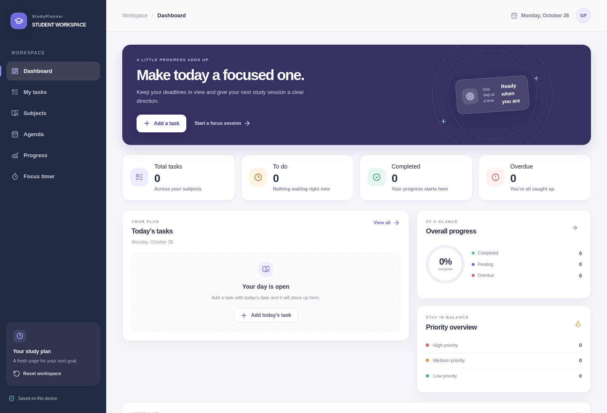

# StudyPlanner

StudyPlanner is a responsive student dashboard for organizing coursework, deadlines, and focused study sessions. It runs entirely in the browser with no API key, database, or paid service.

## Features

- Dashboard with live totals, completion progress, today’s tasks, and upcoming deadlines
- Create, edit, complete, delete, search, filter, and sort tasks
- Organize tasks into editable, color-coded subjects
- Agenda grouped by overdue, today, tomorrow, this week, later, completed, and undated tasks
- Progress summaries and charts derived only from saved tasks
- 25-minute focus and 5-minute break timer
- Responsive desktop sidebar and mobile navigation
- Browser-local persistence with a confirmed workspace reset action

## Tech stack

- Next.js App Router and React
- TypeScript
- Tailwind CSS v4 with semantic theme tokens
- Lucide icons, Recharts, and the project’s shadcn button/chart components
- `localStorage` for persistence; no server-side user data or external APIs

The source prompt named Vite and JavaScript, but this project was already configured for Next.js App Router and TypeScript. The existing setup was retained rather than migrating the application and risking unrelated project changes.

## Run locally

Use the package manager already configured by the project:

```bash
pnpm install
pnpm dev
```

Then open the local development URL shown by Next.js. No environment variables are required. Tasks and subjects are stored in the current browser, so they do not sync across devices or browser profiles.

## Validation

```bash
pnpm exec tsc --noEmit
pnpm build
```

The task create/edit/complete flow, search, local persistence, empty states, focus timer controls, and desktop/mobile layouts were also exercised in the browser.

## Screenshots



This is a browser capture of the real first-run dashboard. No sample tasks or activity metrics are preloaded.

## Deploy to Vercel

1. Connect the project to a Git repository or import it into Vercel.
2. Keep the framework preset set to Next.js; Vercel detects the existing App Router setup.
3. Deploy without adding environment variables.

The app uses browser-local storage, so each visitor gets a separate workspace on their own device.

## Project structure

- `app/page.tsx` — application entry point
- `app/globals.css` — semantic tokens and responsive design system
- `components/study-planner/` — navigation, task forms, and feature views
- `hooks/use-local-storage.ts` — validated browser persistence
- `lib/study-planner.ts` — domain types, defaults, validation, and date utilities

## Product decisions

- Starter subjects are provided, but sample tasks and activity metrics are not fabricated.
- Deleting a subject with linked tasks requires moving those tasks to another subject first.
- The timer runs in the current tab and is intentionally not persisted.
- Resetting the workspace clears tasks and restores the starter subjects.

## Future improvements

- Add calendar month navigation and exportable study summaries.
- Add optional timer/session history and user-configurable study intervals.
- Add an opt-in backend only if cross-device sync or accounts are needed.

## Resume description

Built a responsive, browser-first student productivity app with task CRUD, subject organization, deadline filtering, progress charts, and a Pomodoro timer using Next.js, TypeScript, Tailwind CSS, Recharts, Lucide, and `localStorage`.
